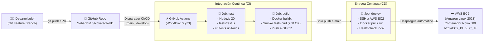

# 🛒 NovaTech S.A.C. - Portal Empresarial y Solución DevOps

[](https://github.com/Sebahhs10/Novatech-HD/actions/workflows/ci.yml)
[](https://hub.docker.com/_/nginx)
[](https://nodejs.org/)
[](https://www.terraform.io/)
[-yellow.svg)](https://github.com/Sebahhs10/Novatech-HD/releases)

Solución DevOps implementada para **Comercial NovaTech S.A.C.** para la entrega final del curso **Herramientas de Desarrollo** (Avance de Proyecto 3). El proyecto integra la arquitectura full-stack colaborativa (Frontend estático/Nginx + Backend API Node.js/MySQL) con las prácticas de gestión de incidencias, Integración Continua (CI), Entrega Continua (CD) hacia AWS EC2 e Infraestructura como Código (IaC).

---

## 📌 Topología de Ramas en el Repositorio

El repositorio [Sebahhs10/Novatech-HD](https://github.com/Sebahhs10/Novatech-HD) maneja el siguiente esquema de ramas:

| Rama | Propósito y Contenido |
|---|---|
| `main` | Rama productiva principal. Contiene la base del proyecto full-stack (v2.1.0, `backend/`, server Express y MySQL). |
| `develop` | Rama de integración continua bajo flujo GitFlow para releases y validaciones previas a producción. |
| `daniel` | Rama de trabajo del módulo Avance 3 (Mesa de Ayuda, suite estricta de 40 tests, Dockerfile corregido, CD deploy job, Terraform). |
| `integration/avance3` | Rama de integración técnica que unifica la base de `main` con el módulo Avance 3 de `daniel` para entrega y resolución de conflictos. |

---

## 📋 1. Descripción del Negocio y Problemática

**NovaTech S.A.C.** es una empresa peruana dedicada a la comercialización y distribución mayorista y minorista de equipos informáticos y periféricos tecnológicos.

### Diagnóstico Operativo Inicial
Antes de la adopción de prácticas DevOps, la compañía enfrentaba los siguientes cuellos de botella:
- ⏱️ **Despliegues manuales de 90 minutos:** El pase a producción requería transferencias manuales por FTP y reinicios no coordinados.
- ❌ **20% de incidentes post-despliegue:** Incompatibilidades en dependencias y rutas rotas (ej. falta de assets como `incidencias.js` en el contenedor).
- 🔧 **45 horas/mes invertidas en tareas repetitivas:** Pruebas manuales propensas a error humano antes de cada entrega.
- 🌐 **Inconsistencia de entornos:** Desalineación entre desarrollo y producción ("en mi máquina sí funciona").
- 📊 **8 a 12 discrepancias mensuales en inventario:** Stock negativo y pedidos sin trazabilidad de estado.

### Solución Implementada
- **Portal Web Multi-Módulo:** Dashboard principal, Módulo de Inventario con semáforo de existencias, Módulo de Pedidos con filtros y Nuevo Módulo de Mesa de Ayuda (Incidencias y Solicitudes) con bitácora y exportación a CSV.
- **Backend API Full-Stack:** Servidor Node.js/Express (`backend/server.js`) con endpoints para sincronización con base de datos MySQL.
- **Pipeline Automatizado CI/CD:** Validación de sintaxis y reglas de negocio en Node 20 (`test`), empaquetado y prueba funcional en Docker (`build`), y despliegue continuo vía SSH hacia AWS EC2 (`deploy`).
- **Gestión de Incidentes en Git:** Sistema formal de tickets, labels semánticas, milestone y cierre automático mediante commits.
- **Infraestructura como Código:** Despliegue reproducible y seguro en AWS mediante Terraform con Amazon Linux 2023 y SSH restringido.

---

## 🏗️ 2. Arquitectura DevOps (Avance de Proyecto 3)



---

## 📂 3. Estructura del Repositorio

```text
Novatech-HD/
├── .github/
│   ├── ISSUE_TEMPLATE/
│   │   ├── incidencia.md          # Plantilla oficial para reporte de bugs e incidentes
│   │   └── solicitud.md           # Plantilla para pedidos de servicio o mejoras
│   ├── PULL_REQUEST_TEMPLATE.md   # Formato estándar de PR con checklist y cierre de issues
│   └── workflows/
│       └── ci.yml                 # Pipeline CI/CD (jobs: test -> build -> deploy)
├── backend/                       # Módulo Backend API (Node.js + Express + MySQL)
│   ├── package.json
│   └── server.js
├── docs/
│   ├── DEPLOY.md                  # Procedimiento de despliegue y guía de secrets
│   ├── GH-SETUP.md                # Configuración de labels, milestone e issues en GitHub
│   ├── LABS.md                    # Evidencia técnica de los 3 Laboratorios del curso
│   ├── PRESENTACION.md            # Guion e índice de la exposición oral (10-12 min)
│   └── VERIFICACION.md            # Checklist de rúbrica, evidencias reales y PENDIENTES
├── scripts/
│   ├── deploy.ps1                 # Script de despliegue local automatizado en Docker
│   ├── setup-github.ps1           # Automatización de creación de labels e issues vía API/gh
│   └── verify-endpoints.js        # Servidor HTTP local para verificación de rutas (sin 404)
├── tests/
│   └── test.js                    # Suite de 40 pruebas en Node puro (exit 0 / exit 1)
├── .dockerignore                  # Exclusión de archivos pesados o sensibles en la imagen
├── Dockerfile                     # Imagen de producción basada en nginx:alpine
├── index.html                     # Dashboard general de NovaTech
├── inventario.html                # Módulo de existencias, stock mínimo y movimientos
├── pedidos.html                   # Módulo de lista de pedidos y filtros de estado
├── incidencias.html               # Módulo de Mesa de Ayuda y seguimiento de casos
├── Login.html                     # Portal de autenticación de operadores
├── script.js                      # Lógica de dashboard, inventario, pedidos y conexión API
├── incidencias.js                 # Controlador del módulo de Mesa de Ayuda
├── style.css                      # Hoja de estilos corporativa NovaTech
├── terraform.tf                   # Propuesta IaC endurecida para AWS (AL2023 + SSH seguro)
└── README.md                      # Documentación principal del proyecto
```

---

## 💻 4. Cómo Ejecutar Localmente

### Opción A: Contenedor Docker (Recomendado)
```powershell
# Ejecución automatizada con verificación de salud
.\scripts\deploy.ps1 -Tag "v1.0.0" -Port 8080
```
O directamente con Docker CLI:
```bash
docker build -t novatech:latest .
docker run -d -p 8080:80 --name novatech-local novatech:latest
```
Abre en tu navegador: [http://localhost:8080](http://localhost:8080)

### Opción B: Modo Node.js (Sin Docker)
```bash
# 1. Ejecutar verificación de endpoints nativa
node scripts/verify-endpoints.js

# 2. Servir los archivos estáticos
npx serve -l 8080 .
```

### Opción C: Backend API (Opcional, entorno MySQL)
```bash
cd backend
npm install
npm start
```

---

## 🧪 5. Pipeline CI/CD Explicado Job por Job

El archivo [.github/workflows/ci.yml](file:///.github/workflows/ci.yml) define las tres etapas del ciclo DevOps:

### 1️⃣ Job `test` (Integración Continua)
- **Ejecuta en:** `ubuntu-latest` (Node.js v20 nativo).
- **Acción:** Ejecuta [tests/test.js](file:///tests/test.js), cubriendo:
  - Sintaxis de código (`node --check`).
  - Existencia de 12 archivos requeridos.
  - Validación de directivas críticas en `Dockerfile` y `.dockerignore`.
  - Integridad de vistas HTML principales.
  - Reglas de negocio: códigos con prefijo `PED-`, estados de entrega válidos, importes > 0, cálculo consistente de totales y códigos de incidencias (`INC-` / `SOL-`).
  - **Control de flujo:** Si falla una sola aserción, termina con `process.exit(1)`, cancelando los siguientes jobs.

### 2️⃣ Job `build` (Empaquetado y Verificación Funcional)
- **Depende de:** `test` (`needs: test`).
- **Acción:**
  - Construye la imagen Docker con tags `novatech:latest` y `novatech:<SHA>`.
  - Inicia un contenedor de prueba efímero en el runner (`docker run -d -p 8080:80`).
  - Realiza peticiones con `curl -fsS` a cada vista (`/`, `index.html`, `inventario.html`, `pedidos.html`, `incidencias.html`, `Login.html`) y a cada script (`script.js`, `incidencias.js`, `style.css`), comprobando respuesta HTTP 200 sin errores 404.
  - Si el commit pertenece a `main` o `develop`, publica la imagen en **GitHub Container Registry (GHCR)**: `ghcr.io/sebahhs10/novatech-hd:latest`.

### 3️⃣ Job `deploy` (Entrega Continua a AWS EC2)
- **Condición de ejecución:** Exclusivamente en eventos `push` hacia la rama `main`.
- **Estado actual:** Pipeline definido en `.github/workflows/ci.yml` (ejecución pendiente en `main` tras configuración de secretos de AWS).
- **Acción:**
  - Valida la disponibilidad de los secretos de despliegue.
  - Conecta por SSH hacia el servidor EC2 mediante la acción oficial `appleboy/ssh-action@v1.0.3`.
  - Descarga la versión más reciente desde GHCR.
  - Realiza un reinicio controlado del contenedor (`--restart always -p 80:80`).
  - Ejecuta un smoke test final con curl en la instancia.

---

## 🔐 6. Despliegue en la Nube y Secretos Requeridos

Para habilitar la entrega automática hacia AWS EC2, se deben configurar los siguientes secretos en GitHub (`Settings` > `Secrets and variables` > `Actions`):

| Secret | Descripción | Requerido | Estado |
|---|---|---|---|
| `EC2_HOST` | Dirección IP pública o DNS del servidor AWS EC2 | Sí | PENDIENTE (configurar en GitHub) |
| `EC2_USER` | Usuario SSH (`ec2-user` para Amazon Linux 2023) | Sí | PENDIENTE (configurar en GitHub) |
| `EC2_SSH_KEY` | Clave privada SSH (`.pem`) completa con cabeceras | Sí | PENDIENTE (configurar en GitHub) |
| `EC2_SSH_PORT` | Puerto de conexión SSH (default: 22) | Opcional | Opcional |
| `GHCR_TOKEN` | Token personal de GitHub si el paquete GHCR es privado | Opcional | Opcional (usa GITHUB_TOKEN por defecto) |

> Consulta el procedimiento completo y la configuración de llaves en [docs/DEPLOY.md](file:///docs/DEPLOY.md).

---

## 🛠️ 7. Gestión de Incidentes en Git (Criterio 1 de Rúbrica)

La gestión de incidentes se realiza de manera nativa y transparente en GitHub:

### Etiquetas del Repositorio:
- **Por Tipo:** `incidencia` (errores), `solicitud` (requerimientos de soporte/mejora).
- **Por Prioridad:** `prioridad-alta`, `prioridad-media`, `prioridad-baja`.
- **Por Módulo:** `modulo-inventario`, `modulo-pedidos`, `modulo-incidencias`.

### Ciclo de Vida:
```
[ Abierto ]  ──▶  [ En atención ]  ──▶  [ Resuelto ]
```

### Cierre Automático:
Los commits o Pull Requests cierran las issues automáticamente al utilizar palabras reservadas:
```bash
git commit -m "fix(docker): resolver carga de incidencias.js en contenedor

Closes #N"
```
> Consulta la guía de configuración y las 6 issues completas en [docs/GH-SETUP.md](file:///docs/GH-SETUP.md).

---

## 🧪 8. Evidencia de los 3 Laboratorios del Curso

El proyecto da cumplimiento a los tres laboratorios académicos:
- **Laboratorio 1:** Control de versiones, ramas, plantillas de issues, milestone y PR con revisión.
- **Laboratorio 2:** Pipeline de Integración Continua con GitHub Actions, Dockerfile corregido y 40 pruebas en Node.js.
- **Laboratorio 3:** Entrega Continua hacia AWS EC2, script `scripts/deploy.ps1` e Infraestructura como Código en `terraform.tf`.

> Consulta las matrices y enlaces de evidencia en [docs/LABS.md](file:///docs/LABS.md).

---

## 🌐 9. URL de la Aplicación Desplegada

- **Ambiente de Producción en la Nube:**
  `http://<EC2_PUBLIC_IP>` *(PENDIENTE: Se asignará al aprovisionar con Terraform y desplegar en EC2)*
- **Ambiente Local de Desarrollo:**
  [http://localhost:8080](http://localhost:8080)

---

## 📄 10. Licencia y Equipo de Desarrollo

Este proyecto está distribuido bajo la licencia **MIT**. Desarrollado para el curso **Herramientas de Desarrollo** (Avance de Proyecto 3) - NovaTech S.A.C.
